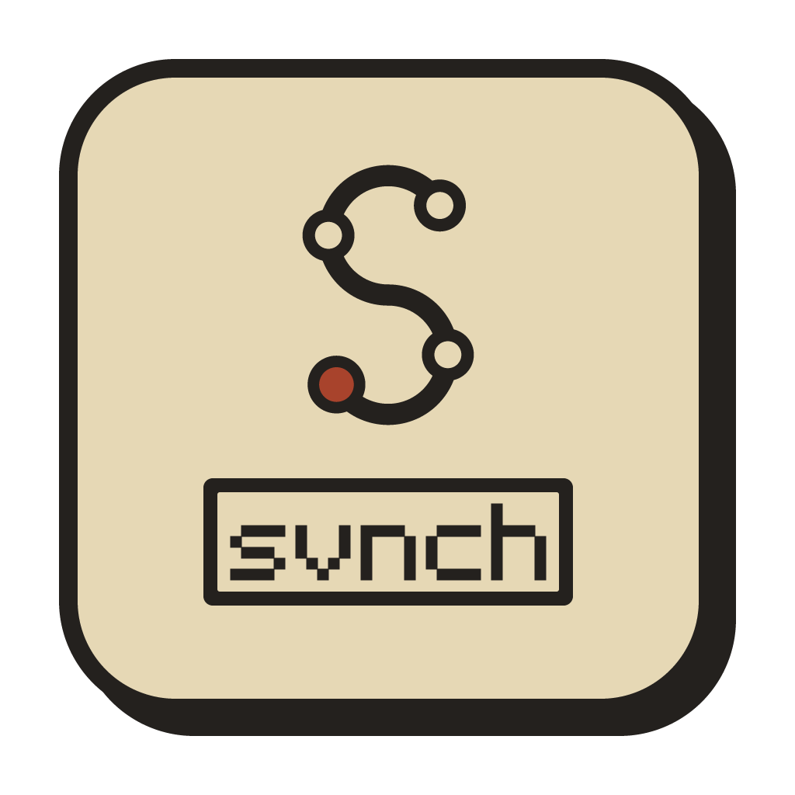

# svnch

A small desktop client for Subversion.

svnch requires `svn` cli commands.

## What it does

Check out, update and commit; see what changed and the diff of each file;
add, delete, revert and rename from a right-click; read the log; merge and
shelve. Saved servers and a repository browser mean you never type a URL
twice.

## Building

You need Go, Node.js and the Wails v3 CLI.

    make dev         run while developing
    make             build bin/svnch

## Subversion

If `svn` is not installed, svnch tries to install it on first start (apt,
dnf, pacman or zypper on Linux, Homebrew on macOS, winget on Windows), and
shows how to do it by hand when it cannot.

When a server asks for a password, svnch asks you. svn keeps it in your
system keyring where it can.

## License

MIT, see [LICENSE](LICENSE).
